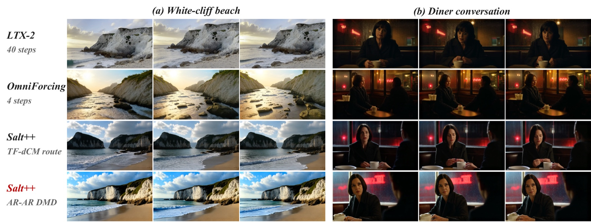
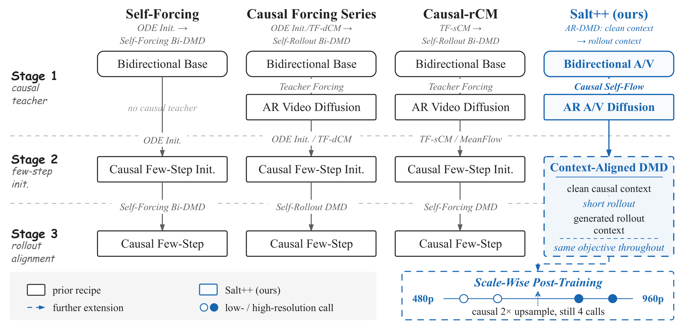
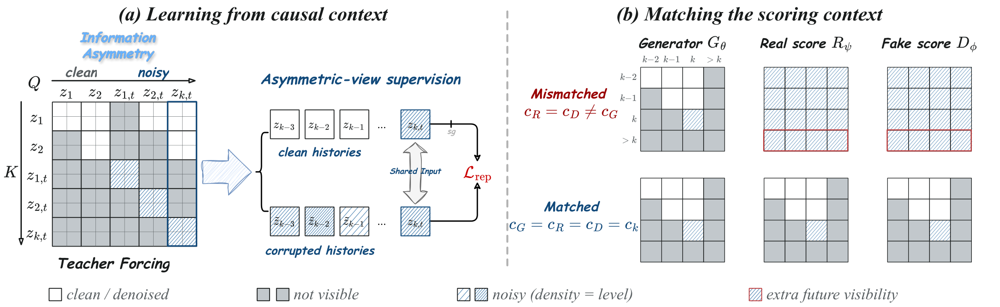
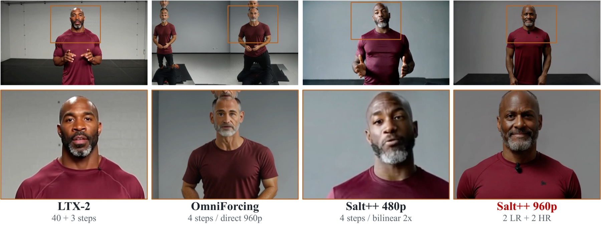

# 🧂 Salt++: Context-Aligned Post-Training for Few-Step Streaming Multimodal Generation

[](https://arxiv.org/abs/2609.36995)
[](https://arxiv.org/pdf/2609.36995)
[](https://xingtongge.github.io/Saltpp/)

Xingtong Ge<sup>1,2</sup>, Yutong Wang<sup>3</sup>, Lunjie Zhu<sup>1</sup>, Haitao Lin<sup>4</sup>, Fangyu Lin<sup>1</sup>, Yushi Huang<sup>1</sup>, Xin Zhang<sup>2</sup>, Yi Zhang<sup>2</sup>, Yu Liu<sup>2</sup>, Jun Zhang<sup>1</sup>

<sup>1</sup>The Hong Kong University of Science and Technology, <sup>2</sup>Vivix Group Limited, <sup>3</sup>The University of Sydney, <sup>4</sup>Westlake University

Preprint, 2026

> A successor to [Salt](https://github.com/XingtongGe/Salt), extending few-step
> distribution matching from video distillation to causal joint audio–video
> generation.

## 📝 Abstract

Few-step streaming audio–video generation requires both causal modeling and step
distillation, yet standard training recipes face two context-related challenges.
Teacher forcing pairs clean history with a noisy target, but supervises
predictive contextual representations only indirectly through velocity
prediction. Meanwhile, directly reusing bidirectional score models in causal
Distribution Matching Distillation (DMD) creates a mismatch between generation
and scoring contexts. We address these challenges with **Salt++**, a two-stage
post-training framework comprising Causal Self-Flow (CSF) and context-aligned
autoregressive DMD. CSF exploits contextual information asymmetry by varying the
history while keeping the noisy target fixed: a noise-mixed-history student
aligns its intermediate representations with those of a clean-history
exponential-moving-average teacher. This self-supervised signal encourages the
student to extract semantic information and improves cross-modal alignment.
Context-aligned AR DMD shares the causal mask and prefix across generator
sampling, fake-score training, and real-score evaluation to match generated and
reference distributions under a block-conditional KL objective. With calibrated
teacher guidance, it performs clean-prefix few-step distillation and then adapts
to generated histories without switching objectives or requiring separate
consistency distillation. At 480p, Salt++ improves visual and motion quality by
57% and 45% over OmniForcing on JavisBench under the same 4-step causal setting.
A separate scale-wise post-training stage extends Salt++ to 4-step 1664×960
generation, outperforming bidirectional LTX-2 on six of seven reported metrics.



*Four-step streaming audio–video generation at 480p. Salt++ retains scene and
facial detail that the causal baseline loses at the same step budget.*

🔊 **[Watch the generated clips with audio on the project page.](https://xingtongge.github.io/Saltpp/)**
Audio and video are generated jointly, so audio–visual synchrony can be judged
directly.

## ✅ TODO List

- [x] Paper on arXiv
- [x] Project page with audio–video samples
- [x] Inference scripts
- [ ] Open-source model weights
- [x] Training scripts

Stay tuned 🚀

## 🔍 Method



Prior recipes switch objectives between stages and score the causal generator
with bidirectional models. Salt++ keeps a single AR DMD objective throughout
post-training and only shifts its conditioning from clean context to generated
rollout:

1. **Causal Self-Flow (CSF)** varies the history while holding the noisy target
   fixed, turning contextual information asymmetry into a representation-learning
   signal for the autoregressive teacher.
2. **Context-aligned AR DMD** shares one causal mask and prefix across generator
   sampling, fake-score training, and real-score evaluation, so distribution
   matching alone suffices — no separate consistency-distillation stage.
3. **Scale-wise post-training** extends the recipe to 1664×960 with two
   low-resolution and two high-resolution generator calls per block, still four
   generator calls in total.



*Two roles of causal context in post-training. **(a)** CSF exploits information
asymmetry in causal histories for self-supervised representation learning.
**(b)** Mismatched (top) and aligned (bottom) contexts across the generator,
real score, and fake score.*

---

## 🛠️ Installation & Base Models

### 1. Environment Setup

We recommend Python >= 3.10 and PyTorch >= 2.2 (tested with PyTorch `2.9.1+cu128` for FlexAttention support). You can install the workspace using `uv` or `pip`:

```bash
git clone https://github.com/XingtongGe/Saltpp.git
cd Saltpp

# Option A: uv workspace
uv sync
source .venv/bin/activate

# Option B: editable pip install
pip install -e packages/ltx-core
pip install -e packages/ltx-pipelines
pip install -e packages/ltx-causal
pip install -e packages/ltx-distillation
```

All scripts under `scripts/` also configure `PYTHONPATH` automatically from the repository root.

### 2. Pretrained Base Weights

Download the base foundation weights and place them under `./pretrained/` (or update the paths in `configs/`):

| Component | Source | Default Local Path |
|:--|:--|:--|
| **LTX-2 19B Base** | [`Lightricks/LTX-2`](https://huggingface.co/Lightricks/LTX-2) (`ltx-2-19b-dev.safetensors`) | `./pretrained/LTX-2/ltx-2-19b-dev.safetensors` |
| **LTX-2 Spatial Upscaler** *(for 960p)* | [`Lightricks/LTX-2`](https://huggingface.co/Lightricks/LTX-2) (`ltx-2-spatial-upscaler-x2-1.0.safetensors`) | `./pretrained/LTX-2/ltx-2-spatial-upscaler-x2-1.0.safetensors` |
| **Gemma-3 12B Text Encoder** | [`google/gemma-3-12b-it-qat-q4_0-unquantized`](https://huggingface.co/google/gemma-3-12b-it-qat-q4_0-unquantized) | `./pretrained/gemma-3-12b-it-qat-q4_0-unquantized` |

---

## 🚀 Quick Start: Inference

Released Salt++ checkpoints are provided in a lightweight `generator_only.pt` format (`{"generator": state_dict, "step": int}`), while full training checkpoints (`model.pt`) are also supported directly.

### 1. 4-Step Streaming Audio–Video Generation (480p)

```bash
# Single prompt demo
python scripts/infer_480p.py \
  --config configs/stage2_context_aligned_dmd/step2_rollout_ar_dmd_4step.yaml \
  --checkpoint ./checkpoints/saltpp_480p/generator_only.pt \
  --direct-generator-checkpoint-load \
  --denoising-update consistency \
  --denoising-step-list 1000,960,889,727,0 \
  --guidance-scale 1.0 \
  --prompt "A close-up of a guitarist strumming an acoustic guitar and singing warmly in a sunlit studio." \
  --output-dir ./outputs/demo_480p
```

### 2. 4-Step Scale-Wise High-Resolution Generation (1664×960, `2LR + 2HR`)

```bash
python scripts/infer_960p_scale_wise.py \
  --config configs/stage3_scale_wise_960p/scale_wise_2lr2hr_960p.yaml \
  --checkpoint ./checkpoints/saltpp_960p/generator_only.pt \
  --prompt "A close-up of a guitarist strumming an acoustic guitar and singing warmly in a sunlit studio." \
  --output-dir ./outputs/demo_960p
```

### 3. Multi-Step AR Teacher Inference (Stage 1 CSF, 40 steps)

```bash
python scripts/infer_480p.py \
  --config configs/stage1_csf_teacher/csf_ar_teacher_480p.yaml \
  --checkpoint ./checkpoints/stage1_csf_teacher/generator_only.pt \
  --direct-generator-checkpoint-load \
  --denoising-update euler \
  --num-inference-steps 40 \
  --guidance-scale 4.0 \
  --prompt "A close-up of a guitarist strumming an acoustic guitar and singing warmly in a sunlit studio." \
  --output-dir ./outputs/demo_teacher_480p
```

See [`eval/README.md`](eval/README.md) for batch generation and evaluation on **JavisBench-mini** and **VBench**.

---

## 🏋️ Post-Training Pipeline

All training scripts launch via `torchrun` and read standard distributed environment variables (`NPROC_PER_NODE`, `NNODES`, `NODE_RANK`, `MASTER_ADDR`, `MASTER_PORT`). Before launching, update the checkpoint and dataset paths in the corresponding YAML config under `configs/`.

### Stage 1: Causal Self-Flow (CSF) AR Teacher

Trains the multi-step causal autoregressive teacher from bidirectional LTX-2 using teacher forcing and CSF representation alignment:

```bash
bash scripts/train_stage1_csf_teacher.sh \
  configs/stage1_csf_teacher/csf_ar_teacher_480p.yaml
```

### Stage 2: Context-Aligned AR DMD (480p)

1. **Step 1 — Clean-Prefix Context-Aligned AR DMD**: Distills the Stage 1 AR teacher into a few-step causal generator using matched causal AR real and fake scores under clean historical prefixes:
   ```bash
   bash scripts/train_stage2_clean_dmd.sh \
     configs/stage2_context_aligned_dmd/step1_clean_prefix_ar_dmd.yaml
   ```
   *(For the TF-dCM ablation route, run `bash scripts/train_stage2_clean_tf_dcm.sh configs/stage2_context_aligned_dmd/step1_clean_prefix_tf_dcm.yaml`.)*

2. **Step 2 — On-Policy Rollout Context-Aligned AR DMD**: Adapts the generator to its own generated KV-cache histories with 4-step random-exit self-forcing rollouts:
   ```bash
   bash scripts/train_stage2_rollout_dmd.sh \
     configs/stage2_context_aligned_dmd/step2_rollout_ar_dmd_4step.yaml
   ```

### Stage 3: Scale-Wise High-Resolution Post-Training (1664×960)

1. **Step 1 — Scale-Wise 2LR + 2HR DMD**: Extends the 4-step causal generator to `2LR + 2HR` (two 480p calls + causal latent upsampling + two 960p calls per block) with separate LR and HR KV caches:
   ```bash
   bash scripts/train_stage3_scale_wise.sh \
     configs/stage3_scale_wise_960p/scale_wise_2lr2hr_960p.yaml
   ```

2. **Step 2 (Exploratory) — Refiner-Guided Reference DPO**: Aligns the high-resolution denoising nodes (`{889, 727}`) with preference pairs constructed from the frozen `2LR + 2HR` reference policy and the bidirectional LTX-2 refiner, without adding the refiner to the deployment graph:
   ```bash
   bash scripts/train_stage3_reference_dpo.sh \
     configs/stage3_scale_wise_960p/scale_wise_anchored_reference_dpo_960p.yaml
   ```
   > **Note on Refiner-Guided DPO:** This stage is an exploratory attempt aimed at distilling the super-resolution prior of the bidirectional LTX-2 refiner into our causal student. Because its training dynamics remained relatively sensitive and unstable on LTX-2, **the final results reported in our paper do not include this DPO stage** (using Step 1 Scale-Wise DMD directly). Nevertheless, we release our full implementation here, as we believe preference-based high-resolution refinement remains a promising direction when paired with stronger and more stable base models (e.g., MiniMax-H3).

### Exporting Lightweight Checkpoints

Full training checkpoints (`model.pt`, ~72–76 GB) include score networks and optimizer states. To export a standalone `generator_only.pt` for inference:

```bash
python scripts/export_generator_ckpt.py \
  --source ./outputs/stage2_step2_rollout_ar_dmd_4step/model.pt \
  --output ./checkpoints/saltpp_480p/generator_only.pt
```

---

## 📂 Repository Structure

```text
Saltpp/
├── configs/
│   ├── data/                           # Example data mixture config
│   ├── stage1_csf_teacher/             # Stage 1: Causal Self-Flow (CSF) AR Teacher
│   ├── stage2_context_aligned_dmd/     # Stage 2: Clean-prefix & Rollout Context-Aligned AR DMD
│   └── stage3_scale_wise_960p/         # Stage 3: 1664x960 (2LR + 2HR) Scale-Wise Post-Training
├── scripts/
│   ├── infer_480p.py                   # 480p causal audio-video inference (T2AV & TI2AV)
│   ├── infer_960p_scale_wise.py        # 1664x960 scale-wise (2LR + 2HR) inference
│   ├── export_generator_ckpt.py        # Export generator_only.pt from training checkpoints
│   ├── train_stage1_csf_teacher.sh     # Stage 1 training launcher
│   ├── train_stage2_clean_dmd.sh       # Stage 2 (Step 1) clean-prefix AR DMD launcher
│   ├── train_stage2_rollout_dmd.sh     # Stage 2 (Step 2) rollout AR DMD launcher
│   ├── train_stage3_scale_wise.sh      # Stage 3 (Step 1) scale-wise 960p DMD launcher
│   └── train_stage3_reference_dpo.sh   # Stage 3 (Step 2) refiner-guided reference DPO launcher
├── packages/
│   ├── ltx-core/                       # Base LTX-2 model components, VAE, and Gemma text encoder
│   ├── ltx-pipelines/                  # Base LTX-2 pipeline utilities
│   ├── ltx-causal/                     # Causal FlexAttention masks, AV block layout, KV cache, RoPE
│   ├── ltx-distillation/               # Salt++ training objectives (CSF, AR DMD, Scale-Wise DMD)
│   └── dataset/                        # Audio-video frame-range dataset and dynamic aspect-ratio loader
└── eval/
    ├── README.md                       # JavisBench-mini & VBench evaluation guide
    ├── EXTERNAL_DEPENDENCIES.json      # Reference model & benchmark dependency manifest
    ├── evaluate_vbench_video_metrics.py
    └── prompts/                        # JavisBench-mini and validation prompt sets
```

---

## 📈 Results

### Table 1: JavisBench-mini, 480p audio–video generation

**Bold** = best, <u>underline</u> = second best among the 4-step rows.

| Model | Causal | Steps | VQ ↑ | MQ ↑ | AQ ↑ | CLIP ↑ | IB-AV ↑ | Javis ↑ | DeSync ↓ |
|:--|:--:|:--:|--:|--:|--:|--:|--:|--:|--:|
| LTX-2 Base | ✗ | 40 | 1.884 | 0.566 | 4.986 | 0.311 | 0.239 | 0.200 | 0.608 |
| AR Teacher (CSF) | ✓ | 40 | 2.304 | 0.857 | 4.565 | 0.316 | 0.202 | 0.162 | 0.746 |
| OmniForcing | ✓ | 4 | 1.807 | 0.699 | 4.718 | 0.303 | 0.163 | 0.124 | <u>0.745</u> |
| Salt++ (TF-dCM route) | ✓ | 4 | <u>2.013</u> | <u>0.826</u> | <u>4.976</u> | <u>0.313</u> | **0.229** | **0.185** | **0.710** |
| **Salt++** | ✓ | 4 | **2.838** | **1.010** | **4.991** | **0.316** | <u>0.184</u> | <u>0.146</u> | 0.759 |

### Table 2: VBench video fidelity and temporal consistency, 480p

| Model | Causal | Steps | Aesthetic ↑ | Imaging ↑ | Subject Consistency ↑ | Background Consistency ↑ |
|:--|:--:|:--:|--:|--:|--:|--:|
| LTX-2 Base | ✗ | 40 | 53.89 | 67.06 | 95.94 | 95.63 |
| OmniForcing | ✓ | 4 | **56.74** | <u>68.41</u> | <u>96.62</u> | 95.32 |
| Salt++ (TF-dCM route) | ✓ | 4 | 53.65 | 62.87 | 96.58 | <u>96.05</u> |
| **Salt++** | ✓ | 4 | <u>55.43</u> | **69.98** | **97.01** | **96.24** |

### Table 3: JavisBench-mini, 1664×960 audio–video generation

**Bold** = best across all methods.

| Model | Causal | Steps | VQ ↑ | MQ ↑ | AQ ↑ | CLIP ↑ | IB-AV ↑ | Javis ↑ | DeSync ↓ |
|:--|:--:|:--:|--:|--:|--:|--:|--:|--:|--:|
| LTX-2 Base | ✗ | 40 + 3 | 2.231 | 0.607 | 4.867 | 0.311 | 0.169 | 0.145 | **0.658** |
| OmniForcing | ✓ | 4 | 2.298 | 0.832 | 4.721 | 0.293 | 0.165 | 0.128 | 0.755 |
| **Salt++** | ✓ | 4 | **2.730** | **0.957** | **5.113** | **0.318** | **0.193** | **0.157** | 0.768 |



*Scale-wise post-training at 1664×960, using two low-resolution and two
high-resolution generator calls per block.*

## 📚 Citation

If you find this work useful, please cite:

```bibtex
@misc{ge2026saltpp,
  title={Salt++: Context-Aligned Post-Training for Few-Step Streaming Multimodal Generation},
  author={Ge, Xingtong and Wang, Yutong and Zhu, Lunjie and Lin, Haitao and Lin, Fangyu and Huang, Yushi and Zhang, Xin and Zhang, Yi and Liu, Yu and Zhang, Jun},
  year={2026},
  eprint={2609.36995},
  archivePrefix={arXiv},
  primaryClass={cs.CV},
  url={https://arxiv.org/abs/2609.36995}
}
```

## 🙏 Acknowledgements

This work builds on [LTX-2](https://github.com/Lightricks/LTX-2) as the
bidirectional audio–video foundation model, follows the causal streaming setup
of OmniForcing, and evaluates with
[JavisBench](https://github.com/JavisVerse/JavisDiT) and
[VBench](https://github.com/Vchitect/VBench). Please also cite the original
projects when using their components.
